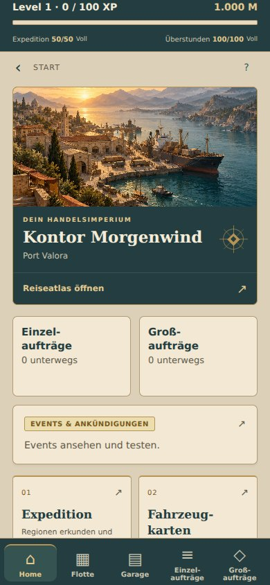
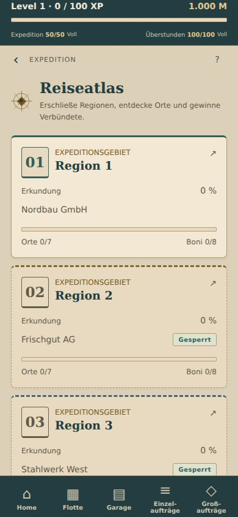
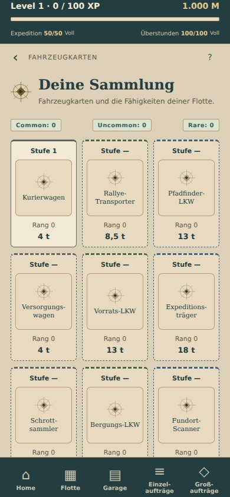

# Gestaltung: Handel und Entdeckung

Verbindliche gestalterische Grundlage für die nächste mobile Spieloberfläche:
**Eine glaubwürdige Welt voller ungewöhnlicher Entdeckungen.**

## Welt und Bildsprache

Eine eigenständige Parallelwelt mit Transport, Handel und Expeditionen. Die Darstellung ist erwachsen, ruhig und atmosphärisch. Bilder verwenden einen leicht malerischen, reduzierten Realismus: natürliche Proportionen, nachvollziehbare Materialien, weiches Licht, vereinfachte Details und dezente Gebrauchsspuren. Die Motive müssen im kleinen mobilen Format erkennbar bleiben.

Fantasievolle Inhalte erhalten dieselbe sorgfältige Darstellung wie gewöhnliche Fahrzeuge. Eine würdevoll ausgestattete Karawane oder ein Elefant mit konstruierter Lastplattform können später neben motorisierten Fahrzeugen stehen. Ungewöhnliche Kombinationen dürfen subtilen Humor erzeugen. Alberne Gesichter, verzerrte Proportionen, grelle Farben und Slapstick gehören nicht zur Bildsprache.

Karawanen, Elefantentransporte, neue Regionen, deren Werte und Gruppenboni sind **künftige Inhaltsideen**. Dieses Designpaket führt sie nicht in Katalog, Spielstand oder Wirtschaft ein.

## Oberfläche

Die Oberfläche erinnert an einen Reiseatlas mit Sammelkarten. Dunkles Tintenpetrol rahmt helle Pergamentflächen ein. Schmale Messingkanten, nummerierte Regionssiegel, Kompassmotive und verbundene Wegpunkte tragen die Atmosphäre. Klare Systemschrift bleibt für Werte, Timer und Aktionen erhalten; eine System-Serifenschrift setzt Überschriften und Kartenakzente. Keine zusätzlichen Schriftdateien oder Laufzeitabhängigkeiten.

Bedienelemente bleiben deutlich erkennbar. Hauptaktionen verwenden Petrol mit heller Schrift, ergänzende Aktionen eine helle Materialfläche. Sperren, Seltenheiten und Zustände besitzen Textbeschriftungen zusätzlich zur Farbe. Gesperrte Regionen bleiben lesbar. Verzierungen werden von der Screenreader-Ausgabe ausgeschlossen.

Die Farbwerte stehen zentral in `src/palette.json`; `src/theme.ts` ergänzt Schriften und regionale Akzente. Helle Materialfarben sind von kontrastreicheren Schriftfarben getrennt. Zum Beispiel ist Messing als Material `#B69352`, Goldschrift auf Pergament dagegen `#79591F`.

| Rolle | Farbton |
| --- | --- |
| Tinte, Navigation | `#243D40` |
| Pergamentfläche | `#F2E8D3` |
| Hintergrund | `#DCD0B8` |
| Hauptaktionen | `#315F59` |
| Messingdetails | `#B69352` |
| Helle Schrift auf Tinte | `#F4EBD8` |

Regionen ergänzen die gemeinsame Gestaltung mit zurückhaltenden eigenen Akzentfarben. Individuelle Landschafts- und Fahrzeugbilder müssen die gemeinsame Perspektive, Lichtführung und Detailtiefe beibehalten. In der Sammlung ist der Kompass ein neutraler Platzhalter bis zur Erstellung passender Fahrzeugillustrationen.

## Erstes umgesetztes Paket

- Start mit eingebetteter Hafenillustration, Firmenschild und direktem Zugang zum Reiseatlas.
- Gemeinsame Gestaltung für Karten, Aktionen, Fortschrittsbalken, Dialoge, Aufträge, Events, Vorräte und weitere bestehende Ansichten.
- Expedition mit Regionssiegeln und verbundenen Ortskarten; Reihenfolge, automatische Fokussierung und sämtliche bestehenden Aktionen bleiben erhalten.
- Sammelkarten mit einheitlichem Rahmen, lesbaren Seltenheitsfarben und neutralem Kompassmotiv.
- Vorhandene Spiellogik, Spielstände, Wirtschaftsparameter und Fahrzeugwerte bleiben unverändert.

## Illustrationsquelle

Die Originalillustration wurde mit dem integrierten Bildgenerierungswerkzeug erstellt und als JPEG für das App-Bundle übernommen. Projektdatei: `assets/art/harbor.jpg`. Sie benötigt zur Laufzeit keine Bild-API oder externe Bild-URL.

Verwendeter Prompt:

> Use case: stylized-concept. Asset type: landscape illustration to be integrated into the home screen of an adult mobile transport and exploration strategy game, not a UI mockup. Create a wide 3:2 painting of a fictional working harbor at dawn, seen from an elevated traveler's viewpoint: warm sandstone warehouses along a curving waterfront, a cargo ship, small believable unbranded cargo trucks by the quay, distant mountains and roads fading into haze. An alternate contemporary world with a sense of discovery and long journeys. Restrained painterly realism, naturally proportioned architecture and vehicles, simplified readable forms, soft brushwork, tactile materials, atmospheric light, mature and quietly adventurous. Palette: deep ink petrol #243D40, warm parchment #E6D8BA, sandstone #B79A73, aged brass #B69352, touches of terracotta #A75F46. Warm dawn highlights balanced against cool teal water and shadows. Detailed but readable at small mobile sizes. Fill entire frame with landscape; no border, no text, no typography, no symbols, no UI, no logos, no watermark. Avoid cartoons, caricatures, cute forms, glossy 3D, photorealism, steampunk, medieval castles, exaggerated proportions, exaggerated saturation. This image is a project asset; return local output path metadata if available.

## Prüfung

TypeScript-Prüfung, alle 67 vorhandenen Tests und der Android-Export mit eingebettetem Bild sind erfolgreich. Die Screenshots unter `docs/design/` zeigen die tatsächlichen React-Native-Komponenten über React Native Web mit einem lokalen Testspielstand. Die Testansicht ersetzt ausschließlich die Firebase-Verbindung; sie wird nicht in die App übernommen. Start, Atlas, Ortsdialog und Sammlung wurden in der lokalen Testansicht bedient. Bei 320, 360, 390 und 430 Pixel Breite gab es keinen horizontalen Überlauf und keine JavaScript-Laufzeitfehler. Ein Test auf einem physischen Android-Gerät ist damit nicht ersetzt.

