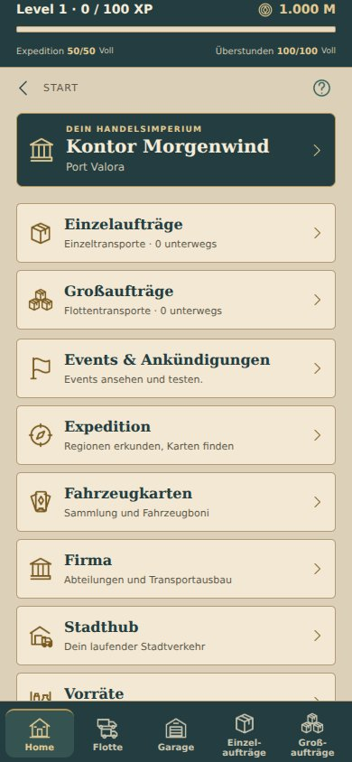

# Kompakte Startseite – vorbereitet, noch nicht veröffentlicht

- Firmenkarte ohne Hafenbild, gesamte Karte öffnet die Firma. Name und Stadt bleiben erhalten.
- Alle Startbereiche als platzsparende volle Zeilen: Icon links, Titel rechts daneben, darunter verpflichtend genau eine Beschreibungszeile. Längere Texte werden am Ende gekürzt, ohne Umbruch. Gilt auch für Einzel-/Großaufträge und Events.
- Stadtbilder auf der Startseite ausgeblendet. Hafenbild und Stadtatlas bleiben unverändert im Assetbestand; die eigenständigen Bereichsseiten behalten ihre Bilder.
- Einzelaufträge: eine Kiste. Großaufträge: drei Kisten. Vorräte: Lagerregal mit Vorratsgefäßen. Gemeinsame Icons gelten auch für das untere Menü und passende Vorratsobjekte.
- Zahnräder: drei erkennbare Zahnräder in verschiedenen Größen. Shards: zwei Bruchstücke mit erhaltenen Rahmen-/Emblemteilen und Bruchkanten als Teile eines größeren Objekts.
- Seltenheitsfarben behalten Grau/Grün/Blau/Violett/Gold, mit klarerem Farbunterschied. Blau-/Violettflächen stärker unterscheidbar; legendäres Gold separat vom allgemeinen UI-Gold geführt.
- Neue Texte im englischen Katalog ergänzt.

Prüfung: Typprüfung, 70 bestehende Tests und Androidexport erfolgreich. Offline-Browserprüfung der tatsächlichen React-Native-Komponenten bei 320/360/390/430 px: Firmenkarte unter 110 px, Bereichszeilen höchstens 70 px, alle zehn Bereichslinks und Firmenziel geprüft, jede Beschreibung genau eine Zeile, kein horizontaler Überlauf, keine JavaScript-Fehler. Englische Ansicht ebenfalls geprüft. Kein Deployment und kein Android-Update ausgelöst.

