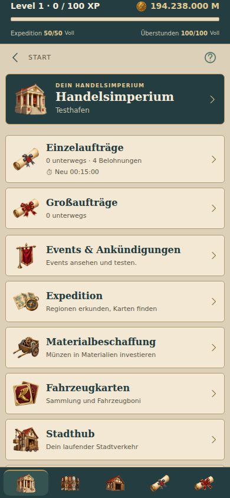
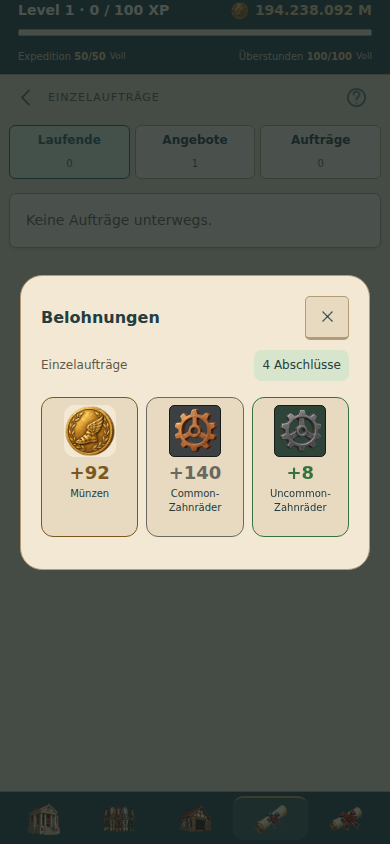

# Hermes-Münze – gesammelte Änderung

Noch nicht veröffentlicht. Gewählt wurde Variante 1 der letzten Musterprobe: eine einzelne, leicht gealterte Goldmünze mit geflügelter Sandale, Lorbeerkranz und glattem erhöhtem Rand. Fast frontale Ansicht, rechts etwas Randstärke sichtbar. Keine Seltenheitsfarbe oder Itemfassung.

Die Produktionsdatei `assets/art/currency/coin.png` wurde mit dem integrierten Bildgenerator anhand der freigegebenen Musterprobe neu freigestellt erzeugt. Der vollständige Prompt, Referenzname und Verarbeitung sind in `assets/art/currency/prompt.json` dokumentiert. Sichtbarer Alphainhalt proportional auf 480 Pixel eingepasst, 16 Pixel transparenter Rand; 512 × 512 Pixel, optimierte PNG-Palette mit erhaltener Transparenz.

`Icon` bleibt die zentrale Darstellung: `name="coin"` verwendet das neue Bild ohne Einfärbung. Dadurch sind alle bestehenden Münzsymbole in Header, Sammelbelohnungen, Firmenausbau, Hub-Kassenbestand, Fahrzeugbetriebskosten und Gewinnanzeige vereinheitlicht, auch wenn die Aufrufer einen Text-/Statusfarbwert übergeben. Funktionale Icons behalten ihre bisherige Einfärbung; fehlende Mittel werden weiterhin über Textfarben angezeigt. Bestehende Größen bleiben erhalten, das Münzbild in Sammelbelohnungen nutzt wie die übrigen Items 52 dp. Die umgebenden Beschriftungen liefern den gesprochenen Kontext; das dekorative Bild wird nicht zusätzlich vorgelesen.

Mengen, Preise, Einheit M, Spielstand und Wirtschaftslogik sind unverändert. Keine neue native Abhängigkeit, Bild statisch gebündelt und offline verfügbar.

## Prüfung

- TypeScript und alle 204 Tests erfolgreich.
- Android-Export erfolgreich.
- Browserprüfung der tatsächlichen App mit lokalem Spielkern: Header und Sammelbelohnungen bei 320/360/390/430 Pixeln ohne fehlende Bilder oder horizontalen Überlauf; keine JavaScript-Fehler.
- Sammelbelohnungen geöffnet und Münzquelle in Header/Modal geprüft; Firmenausbau-Modal geöffnet und dieselbe Münzquelle an den Kosten geprüft.
- Header und Belohnungsmodal visuell auf dunklem beziehungsweise hellem Hintergrund geprüft. Keine Prüfung auf physischem Android-Gerät.

