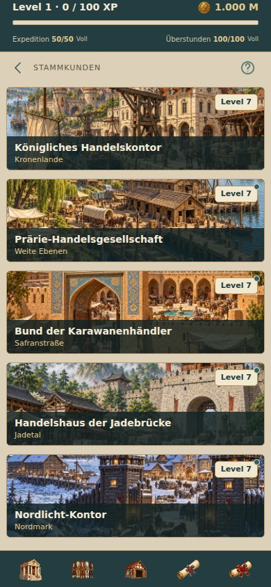
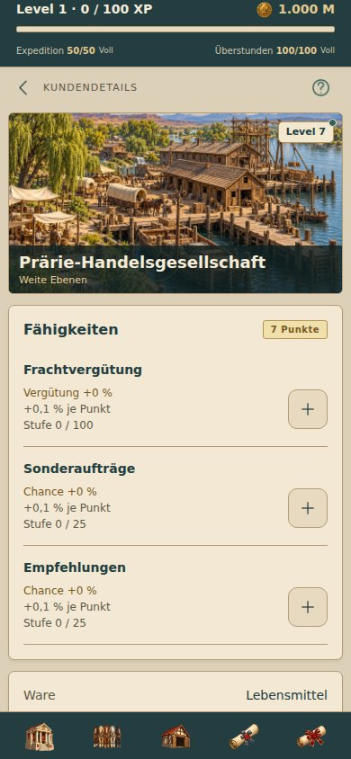

# Regionale Stammkunden – Sammelstand

Unveröffentlicht im Branch `collect/transport-upgrades`.

`functions/src/customer-identities.json` definiert die gemeinsame Anzeigeidentität für mobilen Server und Oberfläche. Stabile IDs, regionale Reihenfolge, Waren, Transportkategorie, Beziehungen, Fähigkeiten und Wirtschaftslogik bleiben erhalten. Der gepinnte Web-Code bleibt unverändert. Alte Kundennamen in historischen Anzeige- und Belohnungstexten werden bei der Ausgabe ersetzt; frei gewählte Firmen-/Stadtnamen bleiben unberührt.

| Region | Stammkunde | Vorhandenes Ortsbild |
|---|---|---|
| Kronenlande | Königliches Handelskontor | Kronenhafen |
| Weite Ebenen | Prärie-Handelsgesellschaft | Weidenhafen |
| Safranstraße | Bund der Karawanenhändler | Karawanserei der sieben Bögen |
| Jadetal | Handelshaus der Jadebrücke | Handelshof am Jadetor |
| Nordmark | Nordlicht-Kontor | Handelsfeste am Eisstrom |

Die Liste verwendet 118 dp hohe Bildkarten (120 dp einschließlich Rahmen). Name und Region liegen auf einem dunklen halbtransparenten Streifen; das Level sitzt in einer kleinen Plakette oben rechts. Die Detailseite zeigt dasselbe Bild mit 200 dp Höhe. Ein Hinweis-Punkt direkt am Level erscheint bei unvergebenen Fähigkeitspunkten und verschwindet nach dem Speichern der letzten Punkte. Beziehungsbalken und rohe Beziehungszahlen entfallen in beiden Ansichten. Keine neuen Bilder oder Kurzbeschreibungen.

## Validierung

- 206 Tests erfolgreich, einschließlich gemeinsamer Identität in Kunden-/Expeditions-/Projektansichten, erhaltener Spielstandwerte, historischer Texte und Punktehinweisen mit/ohne freie Punkte.
- TypeScript erfolgreich.
- Tatsächliche App im Browser mit lokalem Spielkern bei 320/360/390/430 Pixeln geprüft: alle fünf Bildkarten 118 dp hoch, keine fehlenden Bilder, kein horizontaler Überlauf und keine JavaScript-Fehler.
- Detailseite geöffnet, sieben Fähigkeitspunkte verteilt und gespeichert; Restpunkte 0 und Hinweis-Punkt verschwunden.
- Android-Export geprüft. Physischer Android-Gerätetest nicht Teil dieser lokalen Prüfung.

