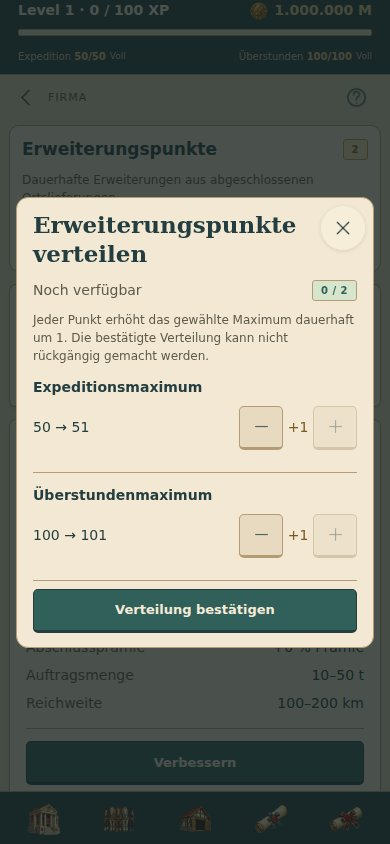

# Automatische Expeditionsabschlüsse und Ausbaupunkte

Implementierungsnotiz zum mobilen Quellstand. Frühere Testzahlen und Layoutprüfungen unten sind historische Nachweise, kein neuer Gesamttest. Aktuelle Veröffentlichungen: [PENDING_UPDATE.md](../../PENDING_UPDATE.md); Prüfstatus: [TEST_REPORT.md](../../TEST_REPORT.md).

## Verhalten

- Der Server schreibt Ortslieferungen und die erste Endlosort-Lieferung bei Abschluss automatisch gut. Weitere Fahrten starten weiterhin nur auf Wunsch des Spielers.
- Ortslieferungen geben jeweils einen freien **Ausbaupunkt**. Die erste Endlosort-Lieferung schaltet den Stammkunden frei und gibt das einmalige Kapazitätsmodul, sofern noch nicht erhalten. Wiederholbare Material- und Fahrzeugkartenaufträge würfeln ihre unveränderte Beute einmal bei Ankunft aus, bewahren sie aber bis zum gemeinsamen Einsammeln unter Einzelaufträge auf. Sie erzeugen keine Expeditionsabschlussmeldung. Der Sammelzähler zählt diese Abschlüsse mit; fertige Einzelcards bleiben ausgeblendet. Das gemeinsame Belohnungsmodal zeigt auch Splitter nach Seltenheit.
- Abschlüsse laufen still im Hintergrund. Es erscheint kein Abschlussdialog und die Punkteverteilung öffnet sich nicht automatisch. Der freie Ausbaupunkt steht sofort unter **Handelsimperium → Entwicklung** zur manuellen Verteilung bereit.
- Bereits gespeicherte rein informative Abschlussmeldungen werden serverseitig still verworfen; Gutschriften, Kundenfreischaltungen und bereits bestätigte Verteilungen bleiben erhalten. Die reguläre Synchronisierung und der Timer für Missionsankünfte bleiben bestehen.

## Dauerhafte Verteilung

Ein Ausbaupunkt erhöht wahlweise das Expeditionsmaximum oder das Überstundenmaximum dauerhaft um eins. Eine eigene Verteilung zeigt die aktuellen und folgenden Maxima und erfordert eine ausdrückliche Bestätigung. Bestätigte Zuteilungen sind nicht zurücksetzbar; unvergebene Punkte bleiben gespeichert und über **Handelsimperium → Entwicklung** erreichbar. Einzelne Punkte oder der gesamte Vorrat können verteilt werden. Zusätzliche, während der Bearbeitung eintreffende Punkte löschen den Entwurf nicht.

Aktuelle Energie wird durch die Verteilung nicht aufgefüllt. Die vorhandene Regeneration behält ihren anteiligen Fortschritt. Levelaufstiege geben dieselben Ausbaupunkte und zahlen in denselben Vorrat ein.

## Bestandsschutz und Wiederholungen

Die Migration erhält bereits abgeholte, fest zugeteilte Expeditionskapazität. Noch nicht abgeholte abgeschlossene Ortslieferungen werden einmalig in Ausbaupunkte umgewandelt; alte bereits gutgeschriebene Beute wird nicht erneut gemeldet. Jede neue Mission erhält eine beständige Abschlussmarkierung. Die Gutschrift ist unabhängig von einer UI-Bestätigung. Der frühere Informations-Posteingang wird nicht mehr befüllt; `notices` bleibt für ältere Clients als leere Liste erhalten.

Die Kompatibilitätsaktion `claimMission` vergibt nichts doppelt. Bei wiederholten Cloud-Befehlen wird die ursprüngliche Aktion nicht erneut ausgeführt; inzwischen fällige Synchronisierungsabschlüsse werden dennoch gespeichert. Die erfolgreiche Punkteverteilung besitzt eine wiederholbar abrufbare Bestätigung im Befehlsbeleg, damit eine verlorene Antwort nicht zum erneuten Verteilen derselben Auswahl führt.

## Historische Prüfung vor der stillen Abschlussvariante

- 216 Tests im vollständigen Lauf erfolgreich. Neue Prüfungen decken Online-/Offline-Abschlüsse, Bündelung, gespeicherte Bestätigung, Altspielstände, einmalige Beute, unveränderte alte Maxima, Grenzen und Unwiderruflichkeit der Punkteverteilung, getrennte Levelpunkte, fehlendes Energie-Auffüllen, Regenerationsfortschritt, Entwurferhalt und Cloud-Befehlswiederholungen ab.
- Nach der letzten Bestätigungsanpassung wurden die betroffenen UI-, Beleg- und Geschenkprüfungen erneut ausgeführt.
- TypeScript und Android-Export erfolgreich.
- Browserprüfung der tatsächlichen App mit lokalem Spielkern: 320/360/390/430 Pixel ohne horizontalen Überlauf oder JavaScript-Fehler. Offline-Abschluss von zwei Orten und einem Stammkunden-Meilenstein gebündelt; X geschlossen, App neu geladen, keine Wiederholung. Zwei Punkte verteilt, beide Maxima erhöht, aktuelle Energie unverändert. Ein weiterer Abschluss während eines offenen Ausbau-Dialogs wartete bis zum Schließen. Öffnen und Schließen der Verteilung erhielt den freien Punkt.
- Die Browserprüfung verkürzt nur in ihrer lokalen QA-Kopie das Synchronisierungsintervall; Produktionsintervall bleibt 30 Sekunden. Kein physischer Android-Gerätetest.

Die frühere Abschlussübersicht auf `expedition-auto-summary.jpg` ist historisch und wird nicht mehr eingeblendet.

## Wiederholbare Aufträge und Altstände

Der Sammelbefehl zahlt reguläre Einzelaufträge und wiederholbare Expeditionsaufträge zusammen aus. Münzen, Zahnräder, Splitter, Module und Firmenausbau-Items werden tatsächlich gutgeschrieben und gemeinsam angezeigt. Ausstehende Missionsbelohnungen überleben die gekürzte Missionshistorie. Wiederholtes Synchronisieren oder Einsammeln würfelt keine neue Beute und zahlt nichts doppelt.

Bereits automatisch ausgezahlte Altaufträge ohne gespeichertes Beutepaket bleiben bezahlt; noch vorhandene Informationsmeldungen dieser Aufträge werden entfernt, ohne Belohnungen zurückzunehmen oder erneut anzubieten. Ortsboni und Kundenfreischaltungen behalten die automatische Verarbeitung.

## Stille Abschlüsse

Der automatische Abschlussdialog und seine Weiterleitung zur Punkteverteilung sind aus der App entfernt. Der Server erzeugt keine neuen Abschlussmeldungen und leert Altmeldungen ohne erneute Gutschrift. Der bisherige Bestätigungsbefehl bleibt für ältere Clients kompatibel. Acht gezielte Runtime-Tests prüfen einmalige Offline-/Online-Gutschrift, Altstände, unabhängige Punkteverteilung und unveränderte Lootabholung; alle erfolgreich. Der entfernte reine Popup-Komponententest entfällt; der Verhaltenstest der manuellen Verteilung bleibt erhalten.

Veröffentlicht mit dem Sammelpaket vom 03.11.2026. Release- und Prüfnachweis: [Prüfstand](../../TEST_REPORT.md). Ein physischer Gerätetest ist nicht belegt.

