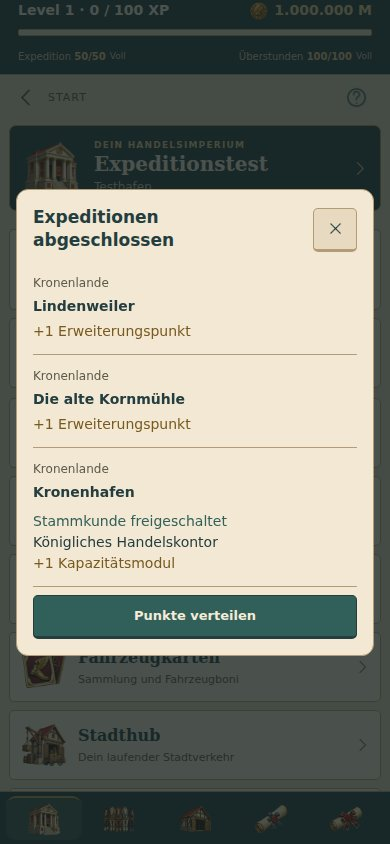
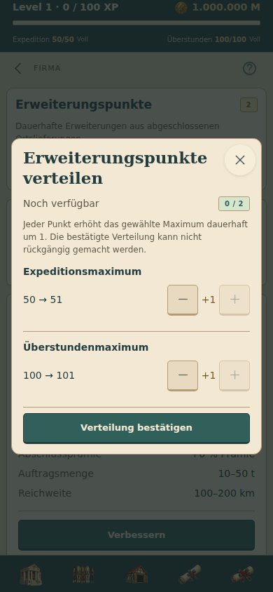

# Automatische Expeditionsabschlüsse und Erweiterungspunkte

Gesammelt im Branch `collect/transport-upgrades`, nicht veröffentlicht.

## Verhalten

- Der Server schreibt Ortslieferungen und die erste Endlosort-Lieferung bei Abschluss automatisch gut. Weitere Fahrten starten weiterhin nur auf Wunsch des Spielers.
- Ortslieferungen geben jeweils einen freien **Erweiterungspunkt**. Die erste Endlosort-Lieferung schaltet den Stammkunden frei und gibt das einmalige Kapazitätsmodul, sofern noch nicht erhalten. Wiederholbare Material- und Fahrzeugkartenaufträge würfeln ihre unveränderte Beute einmal bei Ankunft aus, bewahren sie aber bis zum gemeinsamen Einsammeln unter Einzelaufträge auf. Sie erzeugen keine Expeditionsabschlussmeldung. Der Sammelzähler zählt diese Abschlüsse mit; fertige Einzelcards bleiben ausgeblendet. Das gemeinsame Belohnungsmodal zeigt auch Splitter nach Seltenheit.
- Eine gespeicherte Abschlussübersicht fasst alle noch nicht bestätigten Meldungen zusammen. Beim App-Start, erneuten Einloggen und während des Spiels gilt derselbe Ablauf. X und „Punkte verteilen“ bestätigen die gezeigten Meldungen serverseitig; spätere Synchronisierungen und Neustarts zeigen sie nicht erneut. Ein verlorener Netzwerkaufruf lässt die Übersicht offen und zeigt den Verbindungsfehler, statt Meldungen still zu verlieren.
- Die Übersicht enthält nur ein X oben rechts und unten „Punkte verteilen“. Ohne freie Erweiterungspunkte ist der untere Button deaktiviert. Neue, während einer bereits geöffneten Übersicht eintreffende Abschlüsse bleiben für die nächste Übersicht gespeichert.
- Native Produktdialoge melden ihre Sichtbarkeit zentral über `AppModal`. Die Abschlussübersicht wartet bestehende Dialoge, Fahrzeugauswahl, Levelmeldungen und Hintergrundzustand der App ab, statt darüber aufzuspringen. Die reguläre Synchronisierung und der Timer für Missionsankünfte bleiben erhalten.

## Dauerhafte Verteilung

Ein Erweiterungspunkt erhöht wahlweise das Expeditionsmaximum oder das Überstundenmaximum dauerhaft um eins. Eine eigene Verteilung zeigt die aktuellen und folgenden Maxima und warnt vor der Unwiderruflichkeit. Bestätigte Zuteilungen sind nicht zurücksetzbar; unvergebene Punkte bleiben gespeichert und über **Firma → Erweiterungspunkte** erreichbar. Einzelne Punkte oder der gesamte Vorrat können verteilt werden. Zusätzliche, während der Bearbeitung eintreffende Punkte löschen den Entwurf nicht.

Aktuelle Energie wird durch die Verteilung nicht aufgefüllt. Die vorhandene Regeneration behält ihren anteiligen Fortschritt. Levelaufstiegs-Punkte bleiben ein separater Bestand mit ihrem bisherigen Ablauf.

## Bestandsschutz und Wiederholungen

Die Migration erhält bereits abgeholte, fest zugeteilte Expeditionskapazität. Noch nicht abgeholte abgeschlossene Ortslieferungen werden einmalig in Erweiterungspunkte umgewandelt; alte bereits gutgeschriebene Beute wird nicht erneut gemeldet. Jede neue Mission erhält eine beständige Abschlussmarkierung. Der Informations-Posteingang ist von der gekürzten Missionshistorie unabhängig.

Die Kompatibilitätsaktion `claimMission` vergibt nichts doppelt. Bei wiederholten Cloud-Befehlen wird die ursprüngliche Aktion nicht erneut ausgeführt; inzwischen fällige Synchronisierungsabschlüsse werden dennoch gespeichert. Die erfolgreiche Punkteverteilung besitzt eine wiederholbar abrufbare Bestätigung im Befehlsbeleg, damit eine verlorene Antwort nicht zum erneuten Verteilen derselben Auswahl führt.

## Prüfung

- 216 Tests im vollständigen Lauf erfolgreich. Neue Prüfungen decken Online-/Offline-Abschlüsse, Bündelung, gespeicherte Bestätigung, Altspielstände, einmalige Beute, unveränderte alte Maxima, Grenzen und Unwiderruflichkeit der Punkteverteilung, getrennte Levelpunkte, fehlendes Energie-Auffüllen, Regenerationsfortschritt, Entwurferhalt und Cloud-Befehlswiederholungen ab.
- Nach der letzten Bestätigungsanpassung wurden die betroffenen UI-, Beleg- und Geschenkprüfungen erneut ausgeführt.
- TypeScript und Android-Export erfolgreich.
- Browserprüfung der tatsächlichen App mit lokalem Spielkern: 320/360/390/430 Pixel ohne horizontalen Überlauf oder JavaScript-Fehler. Offline-Abschluss von zwei Orten und einem Stammkunden-Meilenstein gebündelt; X geschlossen, App neu geladen, keine Wiederholung. Zwei Punkte verteilt, beide Maxima erhöht, aktuelle Energie unverändert. Ein weiterer Abschluss während eines offenen Ausbau-Dialogs wartete bis zum Schließen. Öffnen und Schließen der Verteilung erhielt den freien Punkt.
- Die Browserprüfung verkürzt nur in ihrer lokalen QA-Kopie das Synchronisierungsintervall; Produktionsintervall bleibt 30 Sekunden. Kein physischer Android-Gerätetest.

## Wiederholbare Aufträge und Altstände

Der Sammelbefehl zahlt reguläre Einzelaufträge und wiederholbare Expeditionsaufträge zusammen aus. Münzen, Zahnräder, Splitter, Module und Firmenausbau-Items werden tatsächlich gutgeschrieben und gemeinsam angezeigt. Ausstehende Missionsbelohnungen überleben die gekürzte Missionshistorie. Wiederholtes Synchronisieren oder Einsammeln würfelt keine neue Beute und zahlt nichts doppelt.

Bereits automatisch ausgezahlte Altaufträge ohne gespeichertes Beutepaket bleiben bezahlt; noch vorhandene Informationsmeldungen dieser Aufträge werden entfernt, ohne Belohnungen zurückzunehmen oder erneut anzubieten. Ortsboni und Kundenfreischaltungen behalten die automatische Verarbeitung.
