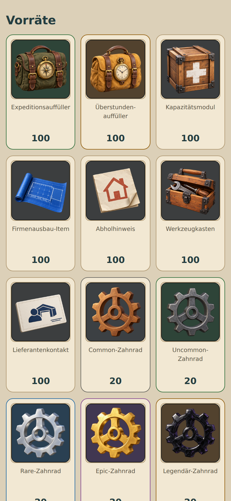
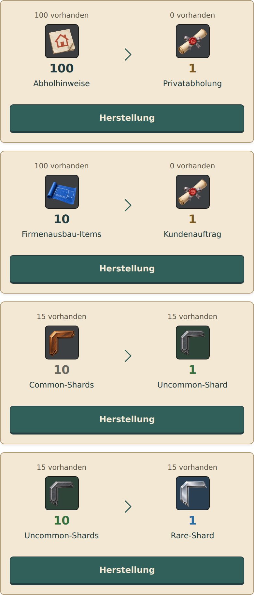
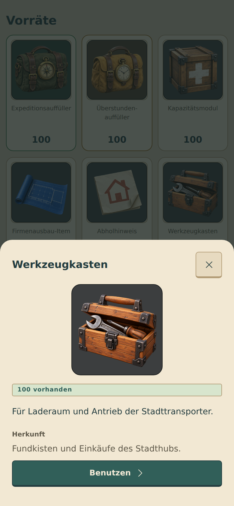
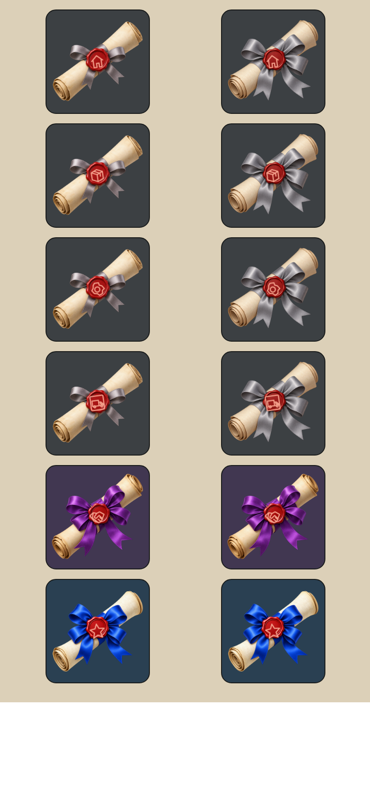

# Einheitliche Itembilder

## Vereinbarte Motive

- Zahnräder: drei Speichen (Muster B); Holz, Eisen, Silber, Gold und Obsidian.
- Splitter: abgebrochene, abgeschrägte Facettenecke eines Fahrzeugkartenrahmens (Variante 1); dieselben fünf Materialien.
- Kapazitätsmodul: Versandholzkiste mit Eisenbeschlägen und weißem Plus (2).
- Firmenausbau: teilweise ausgerollte technische Blaupause mit Gebäudeanbau (1).
- Abholhinweis: gefaltetes Papier mit Haussymbol (2), passend zum Siegel der Privatabholung.
- Auffüller: Stofftasche mit Tragegriff und Lederriemen (3), Kompass für Expedition, Taschenuhr für Überstunden.
- Werkzeugkasten: leicht geöffnete Holzkiste mit Werkzeugen (2). Ersetzt den Anzeigenamen Fahrzeugteil; interner Schlüssel `hubVehicleParts` und alle Bestände bleiben unverändert.
- Lieferantenkontakt: cremefarbene Visitenkarte mit geprägtem Rand, einfacher Personensilhouette und Halle ohne Fenster/Kisten.
- Aufträge: Pergamentrolle, einfache Schleife für Einzelaufträge, prächtige Schleife für Großaufträge. Grau/Grün/Blau/Lila/Orange zeigen Seltenheit. Rotes Wachssiegel trägt Haus, Kiste, Zahnrad, Karte mit LKW, Handschlag oder Stern.

## Technischer Aufbau

`ItemArt` verwendet die lokalen transparenten PNGs aus `assets/art/items`. Die App benötigt keine Bild-API oder zusätzliche native Bibliothek. Rahmen, halbtransparenter Farbhintergrund und römische Stufe entstehen technisch. Mengen stehen weiterhin separat in der jeweiligen Ansicht. Die Auftragsart erscheint als helles Vektorsymbol auf einer kontrastreichen dunklen Plakette oben links (34 % der Itemfläche). Das Wachs bleibt ohne Symbol. Römische Stufen bleiben ausschließlich bei gestuften Items unten rechts. Die sechs Motive werden als scharfe PNGs aus den Vektorquellen vorgerendert. Quelle und optionaler Renderer: `scripts/build-item-seals.cjs`.

`itemVisual.js` trennt Item-ID, Auftragsart, Seltenheit und Rang. Der Rang eines Material-/Fahrzeugkartenauftrags steht als römische Zahl im Item; er erzeugt keine neue Seltenheit. Projektgruppen übergeben ihre tatsächliche Art ausdrücklich. Die Beispiele ändern nicht, welche Auftragsarten im Spiel als Großauftrag existieren.

Einsatz: Vorräte samt Detailansicht, Herstellung, Beschaffungsbeute, Einzel-/Großauftragslisten und Prämien, Kartenverbesserungen und Splitterbestand, Geschenkduplikate, Expeditionsfunde und Fundchancen, Ortsprämien, Levelbelohnungen, Eventbelohnungen sowie Stadthub-Erträge, Kisten und Ausbaukosten. Reine Navigation, Fahrzeugwerte und Punktanzeigen behalten ihre Funktionssymbole.

Die Bilder werden für das Bundle auf 512 × 512 Pixel mit erhaltener Transparenz komprimiert. Diese Auflösung deckt die großen Itemansichten bis 160 dp auch bei dreifacher Pixeldichte ab. Die Erzeugungsprompts liegen bei den Assets; unveränderte Rohbilder bleiben im Erstellungsarbeitsbereich.

## Prüfung

Die Zuordnung wird für die tatsächlich vorhandenen Inventarmaterialien, alle fünf Seltenheiten, die Auftragsarten sowie unabhängige Stufen und Schleifenformen geprüft. Bestehende Spielstands-, Kisten-, Herstellungs- und Modalfalltests bleiben aktiv. Die lokalen UI-Abbildungen verwenden React Native Web mit einem synthetischen Spielstand; sie ersetzen keinen Test auf einem physischen Android-Gerät.

Abgeschlossen: TypeScript ohne Fehler, 198/198 Tests, Android-Export mit 145 eingebetteten Assets. Die Browserprüfung lud 79 Bildinstanzen ohne fehlende Dateien und ohne JavaScript-Fehler; bei 320, 360, 390 und 430 Pixeln kein horizontaler Überlauf. Der Werkzeugkasten-Detaildialog wurde geöffnet und geprüft. Die QA-Einstiegsdateien und der synthetische Spielstand gehören nicht zum App-Bundle.

## Folgeänderung – Auftragsart im Eckkennzeichen

Auftragsart aus der Wachsfläche nach oben links verschoben und vergrößert. Dieselbe zentrale Darstellung gilt an allen Einsatzstellen. Bilder müssen nicht neu erzeugt werden. TypeScript und die drei vorhandenen Prüfungen der Itemzuordnung sind erfolgreich.
