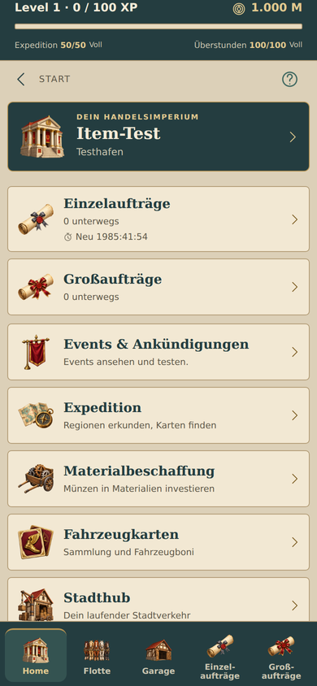
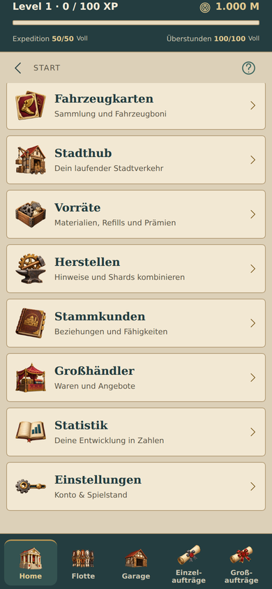

# Bilder für Startmenü und untere Navigation

Die 14 Startziele verwenden die freigegebenen farbigen Miniaturen statt Umrisszeichen. Firma/Home teilen den Verwaltungssitz, Einzel- und Großaufträge ihre jeweilige Auftragsrolle. Die untere Leiste ergänzt das Fünfer-Pferdegespann und die Scheunengarage. Alle Motive sind transparent, ohne Itemrahmen oder Seltenheitsfarbe.

Startzeilen: 48 dp, Firmenkarte: 60 dp, untere Navigation: 36 dp. Proportionale Darstellung und einheitlicher transparenter Rand. Die fünf unteren Schaltflächen bleiben gleich breit und mindestens 66 dp hoch. Aktive Auswahl weiterhin durch Petrolfläche und goldene Oberkante; Bilder behalten ihre Farben. Die gesprochenen Beschriftungen stammen von den Schaltflächen, dekorative Bilder werden nicht doppelt vorgelesen. Auswahlstatus auch explizit über `aria-selected` für die Webdarstellung.

## Validierung

- TypeScript erfolgreich; 198 bestehende Tests erfolgreich.
- Android-Export erfolgreich, statisch gebündelte Menübilder.
- Browserprüfung der tatsächlichen App mit synthetischem Spielstand: 320/360/390/430 Pixel ohne horizontalen Überlauf, 37 geladene Bildinstanzen, keine fehlenden Dateien oder JavaScript-Fehler.
- Alle fünf unteren Tabs betätigt und Auswahlstatus geprüft; Fahrzeugkarten vom Startmenü geöffnet und zurück navigiert.
- Motive auf hellem Zeilenhintergrund und dunkler Navigationsleiste visuell geprüft. Physisches Android-Gerät nicht Teil dieser lokalen Prüfung.

Prompts und Motive: `assets/art/menu/README.md` und `assets/art/menu/prompts.json`. Erzeugt mit dem integrierten Bildgenerator. Keine neuen nativen Abhängigkeiten.

