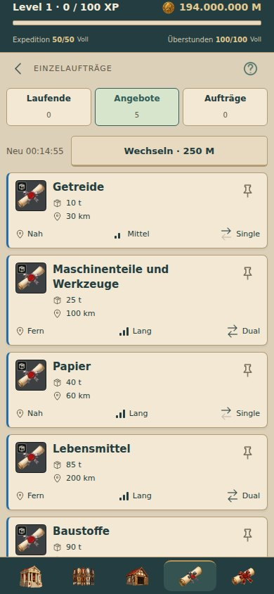

# Einzelaufträge: kompakte Angebotsmerkmale

Unveröffentlicht im Sammelbranch `collect/transport-upgrades`.

Angebote und gespeicherte Einzelaufträge zeigen Tonnen und Kilometer direkt unter dem Warennamen untereinander, neben dem Auftragsbild. In einer festen Merkmalszeile stehen Location-Symbol plus Nah/Fern, ein bis drei aufsteigende Dauerbalken plus Kurz/Mittel/Lang und zwei gegenläufige Frachtpfeile plus Single/Dual. Bei Single ist der Rückpfeil blass: Die Rückfahrt existiert, erfolgt aber leer. Aktive Einzelaufträge verwenden dieselbe Merkmalszeile.

In Angeboten hält oder löst ein separater aufrechter, symmetrischer Pin direkt in der Liste. Gefüllter goldener Pin bedeutet gehalten; ungehalten bleibt er ein dezenter Umriss. Busy-Zustand und die serverseitig vorgegebene Zahl der Halteplätze werden berücksichtigt; Freigeben bleibt bei belegtem Limit möglich. Der Pin hat 44 × 44 dp und liegt oben rechts unabhängig vom Inhaltsfluss. Der Titelbereich reserviert seitlich Platz; es gibt keinen zusätzlichen oberen Abstand für den Pin und damit keine zusätzliche Kartenhöhe. Er ist eine eigene Schaltfläche neben der Auftragsöffnung, sodass er keine Detailnavigation auslöst. Gespeicherte Aufträge und laufende Fahrten haben keinen Haltebutton. Bisherige Regeln für Aktualisierung, Fahrtstart und Rückkehr zum Ursprungsreiter bleiben erhalten.

„Nahverkehr“ ersetzt „Regionalverkehr“ als mobile Anzeigeidentität in Kategorien, Aufträgen, Firmenausbau und Hilfe. IDs (`national`), Routen und Wirtschaft bleiben unverändert. Historische Ausgabetexte werden normalisiert, frei gewählte Firmen-/Stadtnamen dabei geschützt. Die gepinnte Web-Grundlage bleibt unverändert. Englische Bezeichnungen und neue zugängliche Texte sind ergänzt.

Vier kleine ursprüngliche technische Icons sind als SVG-Quelle und PNG gebündelt (Location, Pin leer/gefüllt, Richtungspfeil); keine neue native Abhängigkeit.

## Validierung

- TypeScript und 219/219 Tests erfolgreich; drei gezielte Tests prüfen Halteplätze/Klicktrennung, Busy-Zustand, goldene Füllung, Dauer-/Fahrartsemantik und globale Nahverkehr-Bezeichnung mit geschützten Profilnamen.
- Tatsächliche App mit lokalem Spielkern bei 320/360/390/430 dp: alle Bilder geladen, kein horizontaler Überlauf oder JavaScript-Fehler; langer Warenname geprüft.
- Gewicht/Entfernung bei allen vier Breiten unter dem Namen und linksbündig im selben Textbereich geprüft. Der Faktenblock ist ohne Pin-Zugabe 36 dp hoch.
- Halten/Freigeben in der Liste ausgeführt; belegter Halteplatz deaktiviert andere Pins. Beide Pinaktionen lassen die Liste geöffnet.
- Auftragsdetails und Fahrzeugauswahl geöffnet, Fahrt gestartet: Rückkehr zu Angebote bleibt erhalten.
- Android-Export erfolgreich. Kein physischer Gerätetest in dieser lokalen Prüfung.

