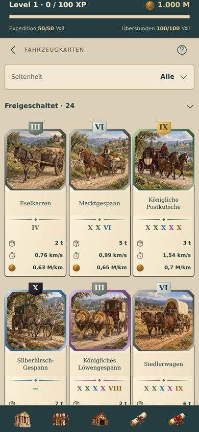

# Fahrzeugkarten – gesammelter Entwurf

Unveröffentlicht im Branch `collect/transport-upgrades`. Die Sammlung übernimmt den freigegebenen Entwurf; ihre drei Spalten bleiben erhalten. Garage, Fahrzeugauswahl und bestehende Detailansicht verwenden weiterhin ihre bisherigen Layouts.

- Fahrzeugbild bildet den oberen Kartenabschluss: bündig links/rechts/oben, vollständige Facette in Seltenheitsfarbe.
- Helle Pergamentfläche und dünner schwarzer Außenrand unter dem Bild. Keine zusätzlichen Eckverzierungen.
- Kleine Stufenplakette mittig oben, halb überstehend. Römische Zahl aus der tatsächlichen Kartenstufe. Einheitlicher dezenter Kontrastrand im Materialton, sanfte Schattierung, keine abgesetzte Oberkante oder Aktivitätsleiste.
- Material nach Stufe, unabhängig von Seltenheit: I–III Eisen, IV–VI Silber, VII–IX Gold, ausschließlich X Obsidian.
- Name in leicht hinterlegter Fläche; darunter Raute und beidseitig spitz auslaufende Linien in Seltenheitsfarbe.
- Bestehende dynamische Kapazität, Durchschnittsgeschwindigkeit und Betriebskosten mit Symbolen bleiben erhalten. Keine Änderungen an Fahrzeugwerten, Besitz, Wirtschaft oder Navigation.
- Gesperrte Karten bleiben als nicht entdeckt gekennzeichnet, mit Gedankenstrich statt erfundener Stufe. Leere Plätze der letzten Reihe behalten dieselbe Spaltenbreite.

Rahmen, Schild und Trennlinie werden nativ aus Ansichten und Farben aufgebaut; keine neuen Bilder oder nativen Abhängigkeiten. `CardLevelShield` kapselt die Stufenplakette, `cardLevelMaterial` deren unabhängige Materialstaffel. Kleine Fahrzeugbilder an anderen Einsatzstellen bleiben unverändert.

## Validierung

207 Tests erfolgreich, einschließlich sämtlicher Materialstufen und ungültiger/fehlender Stufen. TypeScript und Android-Export erfolgreich. Tatsächliche App im Browser bei 320/360/390/430 dp: drei gleich breite Spalten einschließlich letzter Teilreihe, vier Schildmaterialien sichtbar, alle Bilder geladen, kein horizontaler Überlauf und keine JavaScript-Fehler. Karten-Detailaufruf und gesperrte Gruppe geprüft. Physischer Android-Test nicht Bestandteil dieser lokalen Prüfung.

## Geschwindigkeitsrang unter der Trennlinie

Die Sammlung zeigt den tatsächlichen Geschwindigkeitsrang aus `cardVehicles[card.id].rank.total` in einer eigenen, zentrierten Zeile. Jeder erreichte Zehnerabschnitt erhält seine römische Zahl in der entsprechenden Rangfarbe (Common, Uncommon, Rare, Epic, Legendary). Vollständige Abschnitte bleiben als X stehen; zukünftige Abschnitte fehlen. Beispiele: Rang 4 → IV, Rang 26 → X X VI, Rang 50 → X X X X X. Die Kartenstufe auf dem oberen Material-Schild bleibt davon unabhängig.

Die Zeile reserviert bei allen Karten 24 dp Höhe; zwischen den Zahlen liegen 6 dp Abstand. Rang 0 und nicht entdeckte Karten zeigen einen Gedankenstrich. Der zugängliche Kartenname enthält bei entdeckten Sammlungskarten zusätzlich den numerischen Geschwindigkeitsrang. Garage und Fahrzeugauswahl bleiben unverändert. Keine neue Spielmechanik, keine Änderungen an Ausbaukosten oder Fahrzeugwerten.

208 Tests erfolgreich, einschließlich Ranggrenzen 0/1/9/10/11/20/26/33/49/50 und ungültiger Werte. TypeScript und Android-Export erfolgreich. Tatsächliche Sammlung mit einem lokalen Spielkern und gespeicherten Geschwindigkeitsrängen bei 320/360/390/430 dp geprüft: alle Abschnitte passen auch bei Rang 48/49/50, identische Zeilenhöhe, drei Spalten, keine fehlenden Bilder, kein horizontaler Überlauf, keine JavaScript-Fehler. Detailaufruf geprüft.

